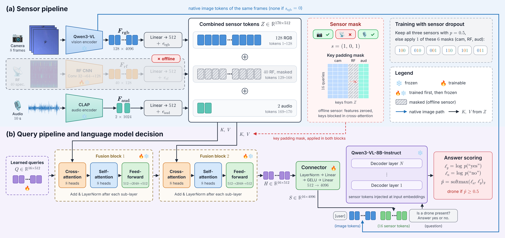

# SENTINEL

Detect drone presence from camera frames, passive RF spectrograms and audio. This IE4422 project compares a learned fusion classifier with a frozen Qwen3-VL-8B-Instruct model under missing sensors and on external datasets.

Use this repository to run the released Version 2 detector, retrain either experiment version, or recompute the reported metrics from saved predictions.



*Figure 1 from the group proposal. The diagram shows a 10-second clip with 40 RF tokens and two audio tokens. A Version 2 decision uses a 1-second window with four RF tokens and one audio token. Both versions use eight camera frames and 16 learned fusion queries.*

The Qwen vision encoder and CLAP audio encoder stay frozen. Training first fits the RF CNN, then the fusion classifier, then freezes both and fits only the connector into Qwen. Qwen receives native camera images when the camera is available. The final decision uses a fixed threshold of 0.5 on the normalized probability of "yes" against "no".

Sensor masks use camera, RF and audio order. For example, `101` keeps camera and audio. The model refuses the all-missing mask `000`.

## Set up the environment

Use Python 3.12, Bash and Make. Verification runs on CPU. Training and model inference require Linux with a CUDA-enabled PyTorch installation and an NVIDIA GPU. Qwen training and validation inference use bf16. The released test and external inference recipes use 4-bit language weights with bf16 vision.

```bash
git clone https://github.com/xena1t/SENTINEL.git
cd SENTINEL
python3.12 -m venv .venv
source .venv/bin/activate
make install
make verify
```

The verification command checks the included weights, sensor masks, data splits and composite rules. It also recomputes 94 saved-result conditions without downloading Qwen, CLAP or raw datasets.

Run `make help` to list the available commands.

## Run the released Version 2 models

The repository includes the trained RF CNN, learned fusion classifier and Qwen dropout connector in `checkpoints/version-2/`. Their checksums are in `checkpoints/version-2/SHA256SUMS`.

Download the pinned Qwen and CLAP models first. This command creates `models/model-paths.json` with the local snapshot paths.

```bash
make models
```

The pretrained models and raw datasets require multi-gigabyte downloads. Downloaded pretrained models, raw media and generated feature caches are excluded from Git.

### Evaluate TRIDENT validation

Fetch the validation media, then run all seven nonempty sensor masks. This target uses bf16 Qwen and compares its predictions with the saved validation references.

```bash
python scripts/infer/download_trident_validation.py
make infer-validation
```

Predictions and metrics are written to `runs/validation-v2/`.

### Evaluate the fixed TRIDENT test

Fetch the test media, then evaluate the released weights with the fixed 4-bit protocol.

```bash
make test-media
make infer-test
```

The test contains 1,961 real windows from 53 recordings. These recordings were already evaluated in Version 1, so this is a repeat evaluation rather than an untouched holdout. The scorer checks the pinned source files, metadata, model revisions and checkpoint checksums.

Test predictions and metrics are written to `runs/test-v2/`. The test commands refuse to overwrite existing result files. To keep another run separate, set a new output directory.

```bash
make infer-test RUNS="$PWD/runs/repeat"
```

### Evaluate RFVS and Halmstad

Download the external datasets, then run the released models without retraining.

```bash
make external-data
make infer-external
```

Results are written to `runs/external/`. RFVS supplies 580 camera and RF pairs. Each pair contains a still image and 30 ms of RF, rather than a 1-second recording. Halmstad video and audio are evaluated separately in nonoverlapping 1-second windows.

## Retrain either experiment version

Download the pretrained models with `make models` before preparation. Preparation fetches development media, trains the RF CNN and caches frozen encoder features. Training then fits the fusion classifier, separate sensor heads and matched Qwen control and dropout connectors.

The control uses all sensors. Dropout keeps all three with probability 0.5 and otherwise samples uniformly from the six incomplete masks.

For Version 2, use 1-second windows at a 0.25-second hop with the committed RGB visibility labels and composite pairs.

```bash
make prepare-v2
make train-v2
```

For the original Version 1 experiment, use whole 10-second clips.

```bash
make prepare-v1
make train-v1
```

Training outputs go to `runs/v2/` and `runs/v1/`. The inference targets above always use the published weights in `checkpoints/version-2/`.

The original Version 1 weights, Version 2 control connector and separate sensor-head weights are not included. Their training recipes and saved predictions are retained. Retraining produces new checkpoints; it does not establish exact reproduction of the unavailable historical weights.

## Recompute saved results

To save the point metrics that `make verify` checks, run the standalone scorer.

```bash
python scripts/verify_results.py --output runs/recomputed-metrics.json
```

This command reconstructs confusion counts, accuracy, macro-F1, recall, false positive rate and AUROC from saved probabilities. It does not run fresh model inference or recompute every bootstrap interval.
